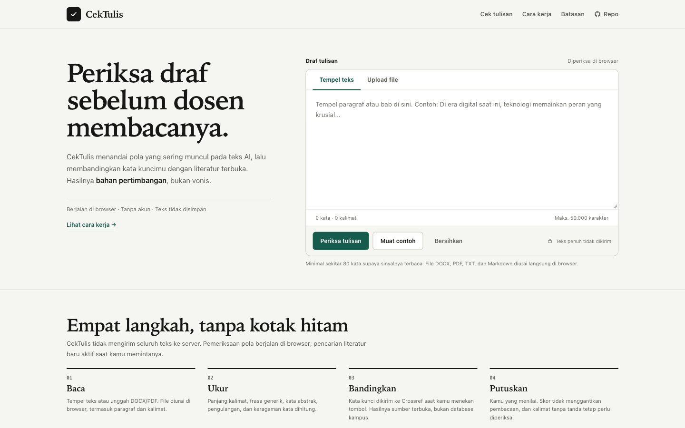

# CekTulis

Alat bantu mahasiswa untuk memeriksa draf tulisan sebelum dikumpulkan: menandai pola yang sering muncul pada teks AI, mencari literatur terbuka yang memakai istilah serupa, dan membandingkan dua dokumen secara lokal.

**Live:** <https://lanangworkk-bit.github.io/cektulis/>



## Yang bisa dilakukan

- **Tempel teks atau unggah DOCX/PDF/TXT/MD.** File diurai di browser; tidak ada unggahan ke server.
- **Sembilan sinyal gaya tulisan.** Variasi panjang kalimat, frasa khas AI, kata abstrak, pembuka generik, pola tiga serangkai, panjang paragraf, em dash, pengulangan awal kalimat, dan keragaman kata.
- **Peta kalimat.** Kalimat bertanda bisa diklik untuk melihat alasan di balik tandanya.
- **Kemiripan literatur.** Kata kunci dikirim ke [Crossref](https://www.crossref.org/) hanya saat tombol ditekan. Hasilnya sumber terbuka, bukan database kampus.
- **Pencarian manual.** Kalau Crossref gagal atau tidak ada hasil, kata kunci yang sama ditautkan ke Crossref, Semantic Scholar, dan Google Scholar.
- **Skor transparan.** Bobot tiap sinyal ditampilkan di laporan; skor adalah jumlah poin dibagi 92, bukan keluaran model bahasa.
- **Perbandingan lokal.** Unggah file pembanding; kemiripan TF-IDF dan pasangan kalimat dihitung di browser.
- **Ringkasan Markdown.** Salin atau unduh laporan berisi skor, sinyal, kalimat bertanda, hasil Crossref, dan perbandingan dokumen. Semua dibuat di browser.
- **Ekspor PDF.** Tombol cetak memakai dialog cetak browser dan menyembunyikan bagian yang tidak perlu.

## Yang tidak bisa dilakukan

- Memberi vonis "ini AI" atau "ini manusia". Skor adalah indikasi berbasis heuristik, bukan probabilitas dan bukan bukti authorship.
- Memeriksa Turnitin atau database karya kampus.
- Menangkap semua parafrase. Kemiripan dihitung dari kata, bukan makna.
- Membaca PDF hasil pindai tanpa lapisan teks (tidak ada OCR).
- Membaca format `.doc` lama; simpan ulang sebagai `.docx` atau PDF.

Gunakan hasilnya untuk memperbaiki tulisan, bukan untuk menuduh orang lain.

## Cara kerja

1. **Baca** — DOCX diurai dengan [Mammoth.js](https://github.com/mwilliamson/mammoth.js), PDF dengan [PDF.js](https://mozilla.github.io/pdf.js/). Keduanya berjalan di browser.
2. **Ukur** — skor 0–100 dihitung dari sembilan sinyal yang bisa diperiksa satu per satu. Batas bawah teks adalah 40 kata; di bawah 200 kata hasilnya ditandai sebagai indikasi awal.
3. **Bandingkan** — kata kunci isi (bukan seluruh teks) dikirim ke Crossref. Kemiripan leksikal dihitung dari kata yang sama.
4. **Putuskan** — pengguna membaca kalimat bertanda dan memutuskan sendiri.

## Privasi

- Tidak ada akun, login, cookie, atau penyimpanan teks.
- DOCX/PDF/TXT/MD diurai di memori browser dan hilang saat halaman ditutup.
- Satu-satunya permintaan jaringan ke pihak ketiga adalah pencarian Crossref, dan hanya setelah tombol **Cek kemiripan** ditekan. Permintaan itu memuat kata kunci, bukan seluruh dokumen.
- Halaman memuat Mammoth.js dan PDF.js dari jsDelivr.

## Menjalankan secara lokal

Tidak ada build step. Karena PDF.js memakai worker dan halaman melakukan `fetch`, jalankan lewat server statis sederhana:

```bash
cd cektulis
python3 -m http.server 8000
```

Lalu buka <http://localhost:8000/>.

## Struktur

```text
cektulis/
├── index.html   # seluruh aplikasi: HTML, CSS, dan JavaScript
├── preview.png  # tangkapan layar untuk README
└── README.md
```

## Lisensi

MIT. Lihat [LICENSE](LICENSE).
